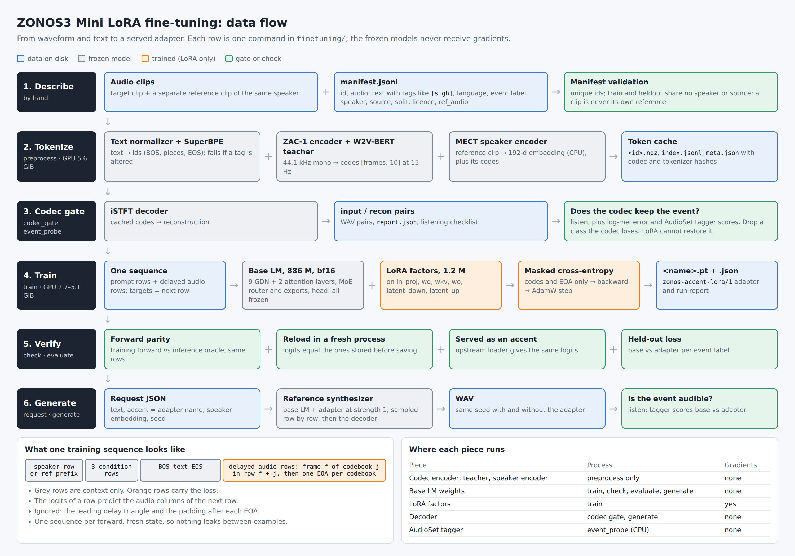

# Fine-tuning overview: status, map and next steps

Start here. This page says where the project stands, how the pieces fit and what to do next. Commands are in
[README.md](README.md); the reasoning and every measurement are in
[the Agent Note](../.agents/notes/implemented/finetuning/2026-11-13-zonos3-mini-lora-finetuning.md).

## In one paragraph

`finetuning/` trains LoRA factors on the frozen ZONOS3 Mini LM from waveform/text pairs and saves them in the
adapter format the model's own synthesizer serves as an accent. The training path is verified against the inference
reference on the real model. A 72-clip pilot on laugh, sigh and gasp shows, by an automatic tagger, that the adapter
learned `[sigh]`. Laugh and gasp are unproven, and nobody has listened to any output.

## Data flow

Source: [docs/pipeline.html](docs/pipeline.html). Re-render with a headless Chromium:
`chrome-headless-shell --hide-scrollbars --force-device-scale-factor=2 --window-size=1500,1050 --screenshot=docs/pipeline.png docs/pipeline.html`.

## Status by phase

| Phase | Goal | Status | Evidence |
|---|---|---|---|
| 0. Sources and design | Find an existing trainer or choose the smallest correct path | Done | No Mini trainer exists; design in the Agent Note |
| 1. Data and preprocessing | Manifest, grouped splits, matched codec tokens, codec gate | Done | 72 of 72 clips re-encode identically; gate pairs written |
| 2. Training forward | Autograd forward equal to the inference reference | Done | Max logit error 5e-5 in float32, top-1 agreement 100 % |
| 3. LoRA, loop, memory | Gradients reach the adapter only; fits on 16 GB | Done | 2.7 GiB allocated for 8 s clips, 4.1 GiB for 24 s |
| 4. Save, reload, serve | Adapter round trip and synthesis | Done in Python; native server not run | Reload bit-identical; upstream loader matches within 2e-5 |
| 5. Nonverbal pilot | Laugh, sigh, gasp with honest evaluation | Partial | Sigh: tagger evidence. Laugh, gasp: none. No listening |

## What is established and what is not

| Claim | Standing |
|---|---|
| The training forward computes the same logits as the shipped reference | Measured on the real model |
| The sequence layout and end-of-audio targets match upstream training | Inferred from inference code, confirmed by the base model's own predictions |
| Only LoRA factors change during training | Asserted in every run and tested |
| The saved adapter is a valid native adapter | Loaded by upstream's Python loader; packed by the GGUF converter |
| The adapter works in the ggml server or the Studio | Not tested |
| The adapter lowers loss on unseen speakers | Measured, 18 of 18 held-out clips, small set |
| `[sigh]` produces a sigh | Tagger score 0.01 → 0.48, 4 of 4 pairs; not listened to |
| `[laugh]` and `[gasp]` work | Not shown |
| Tags work inside a sentence | One sigh sentence scored well; no training clip mixes a tag with words |
| The loss weighting and hyperparameters are right | They are this trainer's choices; upstream's are not public |

## File map

| File | Responsibility | Read it when |
|---|---|---|
| [model.py](model.py) | Teacher-forced forward and the loss | Changing how logits or gradients are computed |
| [lora.py](lora.py) | Trainable factors, save and load in the native adapter format | Changing targets, rank or the file format |
| [sequence.py](sequence.py) | Row layout, delay pattern, targets and loss mask | Changing what is supervised |
| [manifest.py](manifest.py) | Manifest schema, validation, grouped splits | Adding data fields or split rules |
| [preprocess.py](preprocess.py) | Text ids, codec codes, speaker embedding → cache | Changing audio or text preparation |
| [cache.py](cache.py) | Cache layout; cache row → training sequence | Changing what the trainer reads |
| [train.py](train.py) | Training loop, memory report, adapter output | Changing optimization or reporting |
| [check.py](check.py) | Parity with the reference; reload and serving checks | After any change to model.py or lora.py |
| [evaluate.py](evaluate.py) | Held-out loss per event, base against adapter | Comparing adapters |
| [codec_gate.py](codec_gate.py) | Input / reconstruction pairs and checklist | Adding a new sound class |
| [event_probe.py](event_probe.py) | AudioSet tagger scores for clips | Screening events without listening |
| [request.py](request.py), [generate.py](generate.py) | Build requests; synthesize them in one process | Producing samples |
| [pilot/](pilot/) | Pilot manifest and data provenance | Reproducing or extending the pilot |
| [tests/](tests/) | Tiny-model tests, CPU | Always, before committing |

## Rules that keep the results valid

1. `model/` stays unchanged. The reference LM is the oracle the training forward is measured against.
2. After touching `model.py`, `lora.py` or `sequence.py`, run `pytest finetuning/tests` and
   `python -m finetuning.check --cache CACHE --dtype f32`. Float32 max error should stay near 1e-4 or below.
3. One sequence per forward. Batching needs its own proof that no GDN state or attention crosses examples.
4. Train and held-out data never share a speaker or a source recording. An `overfit` split is a plumbing test only.
5. A clip is never its own speaker reference unless the row is marked `self_reference`.
6. New sound classes go through the codec gate before training.
7. Audio, caches, adapters and generated samples stay out of Git.
8. The Studio shares the GPU. Preprocessing needs 5.6 GiB and long unchecked runs up to 6.2 GiB; check free memory
   first and never stop the Studio to make room.

## Next steps, in order

| # | Step | Why | Done when |
|---|---|---|---|
| 1 | Listen to the gate pairs and the 96 samples | The tagger cannot judge laughter and is only a screen for the rest | Checklist filled; each event marked kept or lost |
| 2 | Load the packed adapter in a ggml build made in this worktree, on the CPU | The Studio serves GGUF; only the Python route is proven | `zonos3-cli --accent nv` produces audio that differs from the base |
| 3 | Get laughter data with clear, audible laughs, and more gasps | 14 laugh and 8 gasp training clips were not enough to show an effect | Held-out tagger or listener scores rise for both |
| 4 | Add clips where a tag sits inside a sentence, same speaker | No training clip mixes a tag with words | Sentence samples keep the words and contain the event |
| 5 | Use clean-speech references for every speaker | Embeddings from nonverbal clips push the base model off speech | Each row's `ref_audio` is speech |
| 6 | Chunked GDN rule with a parity gate, then padded batches | The token loop costs 1.2 s per step at 24 s | Same logits as the token loop; faster steps |
| 7 | Resume, learning-rate schedule, held-out early stopping | Needed for runs longer than minutes | A resumed run reproduces an uninterrupted one |
| 8 | Explain the speaker-embedding mismatch with the shipped voice sidecars | Cosine 0.49–0.90 on four voices is unexplained | Native and PyTorch encoders compared on one clip |
| 9 | Decide what VocalSound's ShareAlike terms mean for a shared adapter | Not assessed | A decision recorded here |

## Terms

| Term | Meaning |
|---|---|
| Row | One time step: 10 audio codes plus one text id |
| Delay pattern | Codebook `j` is shifted `j` rows later than codebook 0 |
| EOA | End-of-audio token; each codebook emits one after its last frame |
| Oracle | `zonos3.reference.lm.Zonos3LM.forward`, the shipped inference reference |
| Adapter, accent | A `zonos-accent-lora/1` file; servers select it by name as an "accent" |
| Speaker row / reference prefix | Two ways to condition on a voice: a 192-d embedding in one row, or the reference clip's codes before the text |
| Condition rows | Three rows for loudness, bandwidth and speaking rate; training uses the "unknown" bucket |
| Codec gate | Decode cached codes and compare with the original, before any training |
| Tagger | AudioSet classifier used to score whether an event is audible |
